 

## About

I'm a **Systems Development** student at **ETEC Guarulhos**, and I'm vice-president of the school's **Grêmio Atlas**. I like turning ideas into digital products that actually work.

I'm interested in web development, backend, artificial intelligence and software engineering. My base is **Java**, and I also work with **SQL** on MySQL and **Python**. In the web classes I work with **HTML, CSS, JavaScript and Bootstrap**.

Outside of code, I build and orchestrate AI agents, and I've been studying front-end more closely: layout, responsiveness, accessibility and performance.

## Stack

## AI & orchestration

I build and orchestrate AI agents. They share the same memory, run tasks on their own and connect to tools like GitHub, Figma and email. When a task is big, I split it into pieces and run several agents at once.

## Repositories I contributed to

<table>
<tr>
<td width="50%" valign="top">

### 🎓 TCC — Accounting
Accounting module system for ETEC, in Java Swing. I handled the 4 screens (Entries, Accounting Rules, Reconciliation and DFC) and the models behind them, all aligned to the final SQL database.

</td>
<td width="50%" valign="top">

### 🛍️ Editora Violet
The class's book e-commerce, in HTML, CSS, Bootstrap 5 and JavaScript. The repo has 9 branches from 6 people; mine was `nicollas`, with the cart, search, authors and store policy pages.

</td>
</tr>
<tr>
<td width="50%" valign="top">

### 🚗 Car Rental & Management
Vehicle management and rental system in Java, built as a team with Raphael Chagas.

</td>
<td width="50%" valign="top">

### 📝 Jeffinho-Atividades
The assignments professor Jefferson handed out during the course. Classroom exercises and practice.

</td>
</tr>
</table>

## Statistics

 

## Where to find me

  

<!--
  ANIMATED SNAKE
  After the workflow in .github/workflows/snake.yml runs once
  (repo Actions tab > "Generate snake animation" > Run workflow),
  delete this comment and keep the block below active.

<picture>
  <source media="(prefers-color-scheme: dark)" srcset="https://raw.githubusercontent.com/Nickdpaes/Nickdpaes/output/snake.svg" />
  
</picture>

-->

